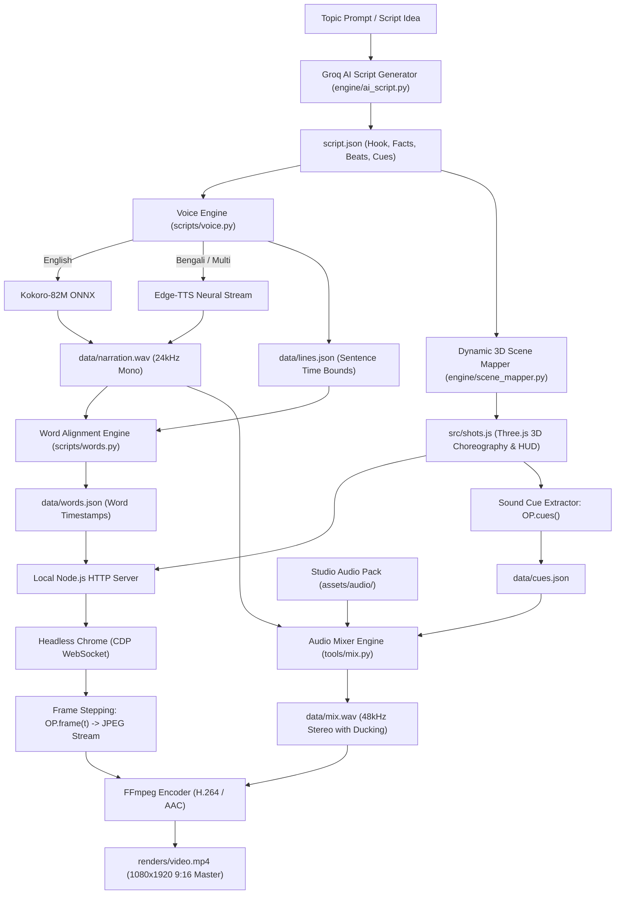

# Faceless Shorts Engine — Automated 3D Animated Vertical Video Generator

<p align="center">
  
  
  
  
  
  
  
  
  
  
  
</p>

<p align="center">
  A 100% free, local, open-source engine for generating viral faceless vertical animated shorts (9:16) for YouTube Shorts, Instagram Reels, and TikTok. Built on Three.js WebGL rendering, Headless Chrome frame-exact capture, dynamic 3D scene mapping, Groq AI script writing, Kokoro-82M & Edge-TTS neural speech synthesis (English & Bengali), faster-whisper word-level alignment, and a cinematic BGM & Foley sound pack without paid subscriptions.
</p>

---

## Table of Contents

- [Overview](#overview)
- [Key Features](#key-features)
- [Core Performance Metrics](#core-performance-metrics)
- [System Architecture](#system-architecture)
- [Web Studio UI](#web-studio-ui)
- [Supported Animation Styles](#supported-animation-styles)
- [Project Structure](#project-structure)
- [Technology Stack](#technology-stack)
- [Prerequisites & System Requirements](#prerequisites--system-requirements)
- [Installation & Local Setup](#installation--local-setup)
- [How to Generate a Video](#how-to-generate-a-video)
  - [1-Click Command-Line Automation](#1-click-command-line-automation)
  - [Bengali Video Generation](#bengali-video-generation)
  - [Web Studio Interactive GUI](#web-studio-interactive-gui)
  - [Step-by-Step Manual Workflow](#step-by-step-manual-workflow)
- [Dynamic 3D Scene Mapping Engine](#dynamic-3d-scene-mapping-engine)
- [Cinematic Audio & Foley SFX Pack](#cinematic-audio--foley-sfx-pack)
- [Demo Showcases](#demo-showcases)
  - [Demo 1: Swallow Gum (English Explainer)](#demo-1-swallow-gum-english-explainer)
  - [Demo 2: Tea & Water Reaction (Bengali 3D Explainer)](#demo-2-tea--water-reaction-bengali-3d-explainer)
- [Hardware Performance & Optimization](#hardware-performance--optimization)
- [Troubleshooting & Known Pitfalls](#troubleshooting--known-pitfalls)
- [Author](#author)
- [License](#license)

---

## Overview

Content creators producing faceless shorts typically spend between $30 and $100 per month on cloud-based AI tools that produce repetitive, low-engagement image slideshows. Commercial alternatives often enforce restrictive rate limits, cloud rendering queues, watermark locks, and subscription paywalls.

**Faceless Shorts Engine** eliminates all external dependencies and recurring subscription costs by executing the complete rendering and production pipeline locally on your workstation. 

### Key Features:
- **Zero Cost Pipeline:** Runs completely offline or with free-tier APIs (Groq, Edge-TTS) on local CPU/GPU hardware without commercial video tool subscriptions.
- **Dynamic 3D Scene Mapping:** Automatically converts raw narrative scripts into choreographed Three.js 3D shots, camera kinematics (`face_dolly`, `esophagus_drop`, `stomach_pan`, `acid_zoom`, `vessel_travel`, `time_spiral`, `wide_pullback`), and 2D HUD callout badges.
- **AI Script Generation:** Generates high-retention, viral short-form scripts formatted with word emphasis (`*word*`) and scene cuts (`|`) via Groq API models (`openai/gpt-oss-120b`, `qwen/qwen3.8-27b`).
- **Multilingual & Bengali Voice Support:** Features offline Kokoro-82M English voices alongside Microsoft Edge-TTS neural voices (`bn-BD-PradeepNeural`, `bn-BD-NabanitaNeural`) with native **Noto Sans Bengali** typography.
- **Studio Audio & Foley SFX Pack:** Synthesizes and bundles high-fidelity 48kHz stereo WAV assets for BGM (`tension`, `mystery`, `phonk`, `upbeat`) and Foley cues (`whoosh`, `gulp`, `impact`, `boom`, `alarm`, `ding`, `sizzle`) with automatic voice-ducking.
- **Web Studio UI:** Built-in FastAPI telemetry server and responsive 3-column Web GUI with 9:16 canvas preview, multi-track timeline, scene editor, and live logs.
- **Frame-Exact Deterministic 3D Graphics:** Three.js rendered inside a headless Google Chrome instance orchestrated via Chrome DevTools Protocol (CDP) WebSocket.
- **Millisecond Word Highlighting:** Transcribes and aligns speech tokens with viral yellow pop captions.

---

## Core Performance Metrics

| Metric | Benchmark Result | Technical Implementation |
| :--- | :--- | :--- |
| **Video Resolution** | 1080 x 1920 (9:16) | Native vertical high definition with safe caption margins |
| **Video Bitrate** | ~4,500 - 5,500 kbps | Progressive H.264 High Profile, YUV420p, faststart flag |
| **Audio Quality** | 48,000 Hz, 192 kbps | AAC stereo with dynamic ducking music bed and Foley bus |
| **Script Generation** | ~2.0 - 3.5 seconds | Groq API inference for 30-45s viral narrative scripts |
| **Voiceover Latency** | ~3.0 - 5.0 seconds | Local Kokoro-82M ONNX or Edge-TTS neural stream |
| **Subtitle Alignment** | Sub-millisecond precision | faster-whisper + SequenceMatcher or neural line bounds |
| **Rendering Speed** | 0.2s - 1.2s per frame | SwiftShader CPU rasterizer (near-instant on dedicated GPUs) |

---

## System Architecture

The following diagram illustrates the complete execution pipeline from raw topic or script to the final master MP4 video:



---

## Web Studio UI

The engine includes a visual web studio interface powered by FastAPI:

<p align="center">
  
</p>

- **AI Creative Director:** Hook score analyzer, retention recommendations, and one-click script regeneration.
- **Scene & Storyboard Timeline:** Visual action editor, format toolbar (`*bold*`, `|` card split, emphasis), and timing controls.
- **Interactive 9:16 Canvas:** Real-time 3D camera staging preview with style selector and voice line testing.
- **Magnetic Multi-Track Timeline:** 4 visual tracks for Voiceover, Foley SFX, Music Bed (with auto-ducking indicator), and Kinetic Captions.
- **Telemetry & Queue:** Live render progress bar, CPU/RAM monitoring, and streaming terminal logs.

To launch the Web Studio:
```bash
python3 -m uvicorn studio.server:app --host 0.0.0.0 --port 8000
```
Then open `http://localhost:8000` in your browser.

---

## Supported Animation Styles

The engine includes production templates and asset libraries across six genres:

| Style Name | Target Genre | Visual Characteristics |
| :--- | :--- | :--- |
| **Deep Dive 3D** | Medical & Science Explainers | Zack D. Films aesthetic, 3D anatomical models, glowing X-ray skeleton, transparent organs, camera macro pans, pill labels. |
| **Tall Tale 3D** | True Crime, Heists, History | Expressive 2D cutout cartoon characters set inside a sunny, depth-of-field 3D world with physical drop shadows. |
| **Inside Out** | Health & Physiology | Clean 2D cross-sections and technical cutaways with smooth procedural transitions. |
| **Stick Story** | Survival & Life Hacks | Fast-paced stick figure scenarios with comedic physical reactions and props. |
| **Night File 3D** | Spooky Mysteries & Dark History | High-contrast eerie 3D lighting, volumetric shadows, desaturated palettes, and atmospheric sound design. |
| **Paper Atlas** | Historical Battles & Empires | Three-dimensional vintage parchment maps, animated nautical routes, and territory boundaries. |

---

## Project Structure

```text
faceless-shorts-engine/
├── assets/
│   ├── audio/                        # Studio BGM & Foley sound pack
│   │   ├── bgm/                      # tension.wav, mystery.wav, phonk.wav, upbeat.wav
│   │   └── sfx/                      # whoosh.wav, gulp.wav, impact.wav, boom.wav, alarm.wav, ding.wav, sizzle.wav
│   └── demo/                         # Preview frames, GIF, and contact sheets
├── engine/                           # Core intelligence engines
│   ├── ai_script.py                  # Groq API high-retention script writer (EN & BN)
│   ├── audio_pack.py                 # Studio 48kHz stereo audio pack synthesizer
│   └── scene_mapper.py               # Dynamic 3D shot synthesizer & camera choreographer
├── studio/                           # Web Studio UI & API backend
│   ├── server.py                     # FastAPI server with system telemetry & render runner
│   └── index.html                    # 3-column studio interface
├── faceless-shorts/                  # Style templates and CLI utilities
│   ├── scripts/
│   │   ├── new_video.sh              # Project scaffold script
│   │   ├── voice.py                  # Kokoro ONNX & Edge-TTS voice synthesizer
│   │   ├── words.py                  # Whisper & Unicode word-level alignment
│   │   └── estimate.py               # Pacing and word budget estimator
│   └── styles/                       # Deep-dive, tall-tale, inside-out, stick-story, etc.
├── projects/                         # User video projects
│   ├── swallow-gum/                  # Complete English demonstration project
│   └── tea-water-bn/                 # Complete Bengali demonstration project
├── generate.sh                       # 1-click full pipeline runner script
├── .gitignore
└── README.md
```

---

## Technology Stack

### Graphics & Browser Capture
- **Three.js (r160+):** Modern WebGL scene graphs, PCFSoftShadowMap, ACESFilmicToneMapping, UnrealBloomPass, BokehPass (Depth of Field), and custom GLSL grade shaders.
- **Headless Google Chrome / Chromium:** Canvas rasterization via `--headless=new` and direct WebSocket Chrome DevTools Protocol control.
- **Node.js (v22+):** Zero-dependency orchestration script using native HTTP server and WebSocket clients.

### Intelligence, Neural Audio & Subtitles
- **Groq API (`openai/gpt-oss-120b`, `qwen/qwen3.8-27b`):** Fast script generation with retention hooks and citation metadata.
- **Kokoro-82M ONNX:** Local neural text-to-speech engine running on ONNX Runtime CPU.
- **Microsoft Edge-TTS:** Cloud neural speech synthesis providing Bengali voices (`bn-BD-PradeepNeural`, `bn-BD-NabanitaNeural`).
- **faster-whisper (CTranslate2):** Local speech recognition engine with CTranslate2 backend.
- **Noto Sans Bengali & Inter:** High-legibility typography rendered natively on the 2D canvas overlay.

### Media Encoding & Audio Synthesis
- **FFmpeg & FFprobe:** High-throughput video stream ingestion (`image2pipe`), H.264 profile encoding, and audio container muxing.
- **NumPy & SciPy Signal:** 48kHz stereo synthesis of procedural audio (Butterworth lowpass/bandpass filters, exponential release envelopes, multi-oscillator frequency sweeps).

---

## Prerequisites & System Requirements

### Supported Operating Systems
- **Linux:** Ubuntu 20.04 LTS or newer (tested on Ubuntu 24.04 and 26.04)
- **macOS:** Apple Silicon (M1/M2/M3/M4) or Intel, macOS 12+
- **Windows:** Windows 10/11 natively or via WSL2 (Ubuntu)

### Required Software
- **Node.js:** Version 22.0.0 or higher
- **Python:** Version 3.10 through 3.14
- **Google Chrome** or **Chromium**
- **FFmpeg:** Version 5.0 or higher with `ffprobe`
- **Bengali Fonts (Optional for Bengali rendering):** `fonts-noto-core` or `fonts-freefont-ttf`

---

## Installation & Local Setup

### 1. Clone the Repository
```bash
git clone https://github.com/Masud744/faceless-shorts-engine.git
cd faceless-shorts-engine
```

### 2. Install System Dependencies

#### On Ubuntu / Debian:
```bash
sudo apt-get update
sudo apt-get install -y ffmpeg google-chrome-stable python3-venv python3-pip fonts-noto-core
```

#### On macOS:
```bash
brew install ffmpeg node
brew install --cask google-chrome
```

### 3. Setup Python Virtual Environment
```bash
python3 -m venv venv
source venv/bin/activate
```

Install the required Python libraries:
```bash
pip install --upgrade pip
pip install kokoro-onnx onnxruntime faster-whisper ctranslate2 scipy numpy audioop-lts edge-tts fastapi uvicorn psutil
```

### 4. (Optional) Configure Groq API Key
If you want to use automated AI script writing, add your free Groq API key to a `.env` file in the root directory:
```bash
echo "GROQ_API_KEY='your_groq_api_key_here'" > .env
```

### 5. Download Free Model Weights
Download the Kokoro-82M ONNX model and voice weights to `~/.faceless-shorts/kokoro/`:
```bash
mkdir -p ~/.faceless-shorts/kokoro
curl -L -o ~/.faceless-shorts/kokoro/kokoro-v1.0.onnx \
  https://github.com/thewh1teagle/kokoro-onnx/releases/download/model-files/kokoro-v1.0.onnx
curl -L -o ~/.faceless-shorts/kokoro/voices-v1.0.bin \
  https://github.com/thewh1teagle/kokoro-onnx/releases/download/model-files/voices-v1.0.bin
```

---

## How to Generate a Video

### 1-Click Command-Line Automation

You can generate a complete video from scratch with a single command:

```bash
chmod +x generate.sh

# Generate from an existing project:
./generate.sh deep-dive swallow-gum

# Generate a brand new video with AI script generation:
./generate.sh deep-dive coffee-facts --topic "What happens inside your brain when you drink coffee?"
```

### Bengali Video Generation

To generate a complete Bengali 3D short explainer with Bengali neural voiceover and subtitles:

```bash
./generate.sh deep-dive tea-water-bn \
  --topic "চা খাওয়ার পর সাথে সাথে পানি খেলে শরীরে কী ঘটে?" \
  --lang bn \
  --voice bn-BD-PradeepNeural
```

### Web Studio Interactive GUI

Launch the Web Studio interface:
```bash
python3 -m uvicorn studio.server:app --host 0.0.0.0 --port 8000
```
Open `http://localhost:8000` to create scripts, preview voices, and track renders interactively.

### Step-by-Step Manual Workflow

#### Step 1: Scaffold a New Project
```bash
bash faceless-shorts/scripts/new_video.sh deep-dive projects/my-video
cd projects/my-video
```

#### Step 2: Write or Generate `script.json`
```json
{
  "title": "What Happens If You Swallow Gum?",
  "style": "deep-dive",
  "voice": "am_michael",
  "music": "tension",
  "lines": [
    { "text": "What happens if you swallow your gum?", "caps": "WHAT *HAPPENS | IF YOU *SWALLOW | YOUR *GUM?" },
    { "text": "Well, it slides down your throat and lands right in your stomach," },
    { "text": "where strong acid gets to work on it." }
  ],
  "sources": ["Mayo Clinic", "Cleveland Clinic", "KidsHealth"]
}
```

#### Step 3: Synthesize Narration Audio
```bash
python ../../faceless-shorts/scripts/voice.py .
```

#### Step 4: Word-Level Subtitle Alignment
```bash
python ../../faceless-shorts/scripts/words.py .
```

#### Step 5: Dynamic 3D Scene Mapping
```bash
python ../../engine/scene_mapper.py . --style deep-dive
```

#### Step 6: Extract Sound Cues and Mix Audio
```bash
node tools/capture.mjs cues
python tools/mix.py .
```

#### Step 7: Render the Final Video
```bash
QS='&res=0.7&aa=2' FPS=24 node tools/capture.mjs video renders/output.mp4
```

---

## Dynamic 3D Scene Mapping Engine

The **Dynamic 3D Scene Mapping Engine** (`engine/scene_mapper.py`) eliminates the need to manually code Three.js shots. It reads the narrative beats from `script.json` and dynamically outputs a clean `src/shots.js` file:

- **Semantic Beat Detection:** Understands medical and anatomical keywords across English and Bengali (e.g. `throat`, `stomach`, `acid`, `vessel`, `heart`, `খাদ্যনালী`, `পাকস্থলী`, `এসিড`, `রক্ত`).
- **Camera Kinematics:** Automatically assigns camera maneuvers:
  - `face_dolly`: Close-up kitchen character shock.
  - `torso_pan`: X-ray descent through the esophagus.
  - `stomach_macro`: Churning stomach acid closeup.
  - `vessel_travel`: Microscopic red blood cell vascular tunnel.
  - `warning_orbit`: Red blockage alarm orbit.
  - `wide_pullback`: Resolution shot with final takeaway badge.
- **HUD Badges & Data Callouts:** Positions 2D canvas HUD pills, percentage rings, and organ labels synchronized with speech.

---

## Cinematic Audio & Foley SFX Pack

Included in `assets/audio/`, the engine provides high-fidelity 48kHz stereo sound assets:

### Background Music Beds (`assets/audio/bgm/`):
- `tension.wav`: Low drone with slow minor pulse and sub-bass resonance.
- `mystery.wav`: Eerie synthesizer pads with subtle arpeggios.
- `phonk.wav`: Aggressive bassline and rhythmic pulse for fast explainers.
- `upbeat.wav`: Warm, energetic major chord progression.

### Foley Sound Effects (`assets/audio/sfx/`):
- `whoosh.wav`: Dynamic stereo frequency transition sweep.
- `gulp.wav`: Realistic biological swallowing sound.
- `impact.wav`: Low-frequency thud with sub-bass drop.
- `boom.wav`: Heavy cinematic riser and explosive impact.
- `alarm.wav`: Pulsing emergency warning siren.
- `ding.wav`: Clean bell chime for takeaway confirmation.
- `sizzle.wav`: Continuous bubbling acid and reaction fizz.

The audio mixer (`tools/mix.py`) automatically ducks the background music by -12dB to -18dB whenever speech is detected.

---

## Demo Showcases

### Demo 1: Swallow Gum (English Explainer)

A complete demonstration project is included in `projects/swallow-gum/`.

| File | Resolution | Duration | Framerate | File Size |
| :--- | :--- | :--- | :--- | :--- |
| `projects/swallow-gum/renders/swallow_gum.mp4` | 1080 x 1920 (9:16) | 34.88 seconds | 24 FPS (837 frames) | 17 MB |

<p align="center">
  
</p>

---

### Demo 2: Tea & Water Reaction (Bengali 3D Explainer)

A complete Bengali explainer project is included in `projects/tea-water-bn/`.

| File | Resolution | Duration | Framerate | File Size |
| :--- | :--- | :--- | :--- | :--- |
| `projects/tea-water-bn/renders/tea-water-bn.mp4` | 1080 x 1920 (9:16) | 32.46 seconds | 24 FPS (779 frames) | 18 MB |

- **Topic:** *"চা খাওয়ার পর সাথে সাথে পানি খেলে শরীরে কী ঘটে?"*
- **Voiceover:** `bn-BD-PradeepNeural` (Natural Bengali male voice)
- **Subtitles:** Noto Sans Bengali with golden keyword pop
- **3D Scenes:** 8 dynamic shots featuring stomach churning, anthocyanin chemical reactions, acidity warnings, and scientific takeaways.

---

## Hardware Performance & Optimization

Headless Chrome renders Three.js using software rasterization (`SwiftShader`) on systems without dedicated graphics hardware. The following query string parameters can be passed to adjust rendering speed:

```bash
# High Quality Mode (Native 1080p, 4x MSAA, 30 FPS)
node tools/capture.mjs video renders/out.mp4

# High Speed CPU Mode (70% 3D buffer upscaled to 1080p, 2x MSAA, 24 FPS) - Recommended for Laptops
QS='&res=0.7&aa=2' FPS=24 node tools/capture.mjs video renders/out.mp4

# Ultra Fast Draft Mode (60% 3D buffer, MSAA off, draft compression)
QS='&res=0.6&aa=0&shadow=1024' FPS=24 node tools/capture.mjs video renders/out.mp4 --draft
```

*Note: Text overlays, captions, and 2D canvas labels are rendered natively at full 1080x1920 resolution regardless of the 3D buffer setting.*

---

## Troubleshooting & Known Pitfalls

### Python 3.14 Standard Library Changes
Python 3.14 removed the built-in `audioop` module. Install the standalone replacement:
```bash
pip install audioop-lts
```

### Bengali Subtitle Font Missing
If Bengali text renders as blank boxes or default serif fallback, install the Noto Sans Bengali font package:
```bash
sudo apt-get install -y fonts-noto-core fonts-freefont-ttf
```

### DevToolsActivePort Port Errors
If Chrome fails to boot inside Docker or headless servers, ensure the following flags are present in `tools/capture.mjs`:
```javascript
'--headless=new', '--no-sandbox', '--disable-gpu-blocklist', '--enable-unsafe-swiftshader'
```

---

## Author

**Shahriar Alom Masud**  
B.Sc. Engg. in IoT & Robotics Engineering  
University of Frontier Technology, Bangladesh  

- Institutional Email: [shahriar0002@std.uftb.ac.bd](mailto:shahriar0002@std.uftb.ac.bd)  
- Personal Email: [masud.nil74@gmail.com](mailto:masud.nil74@gmail.com)  
- LinkedIn: [https://www.linkedin.com/in/shahriar-alom-masud](https://www.linkedin.com/in/shahriar-alom-masud)  
- GitHub: [@Masud744](https://github.com/Masud744)

---

## License

This project is licensed under the MIT License. You are free to use, modify, distribute, and monetize videos created with this software without royalties or attribution requirements.
