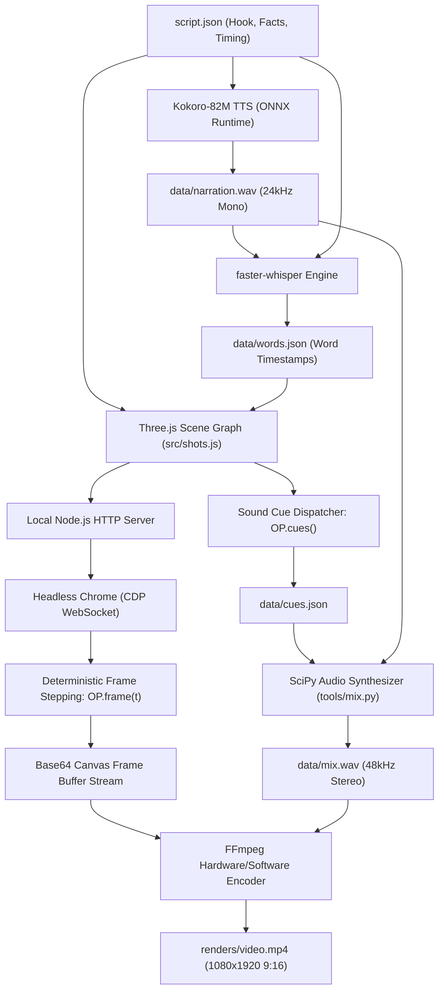
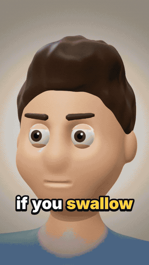
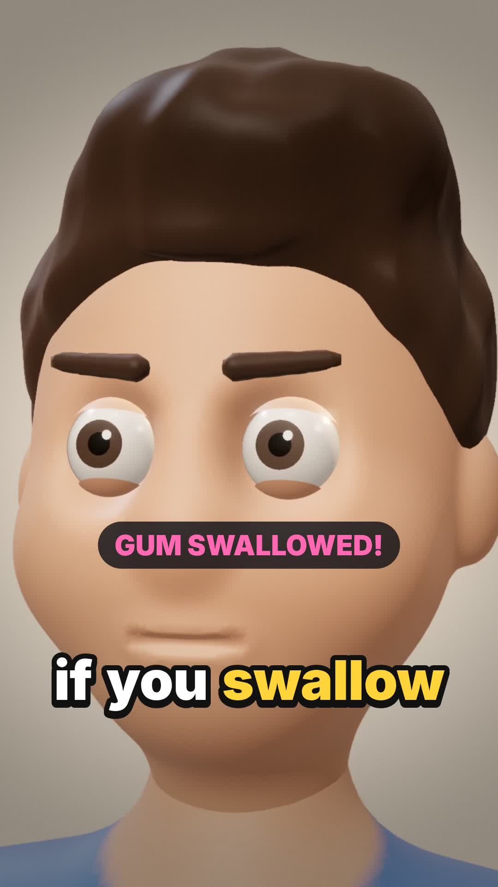
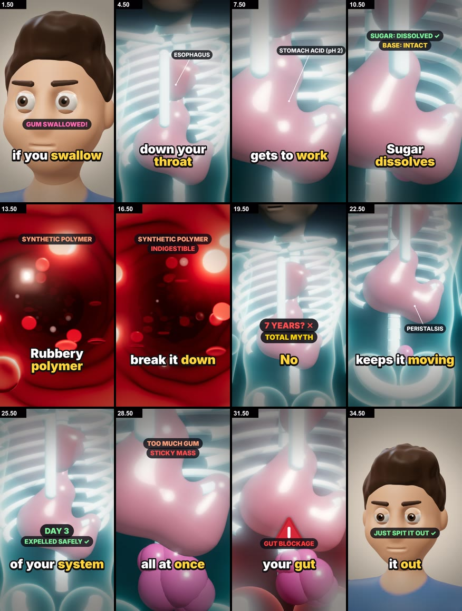

# Faceless Shorts Engine — Automated 3D Animated Vertical Video Generator

<p align="center">
  
  
  
  
  
  
  
  
  
</p>

<p align="center">
  A 100% free, local, open-source engine for generating viral faceless vertical animated shorts (9:16) for YouTube Shorts, Instagram Reels, and TikTok. Built on Three.js WebGL rendering, Headless Chrome frame-exact capture, local Kokoro-82M ONNX neural speech synthesis, faster-whisper word-level alignment, and SciPy-powered procedural audio synthesis without paid external APIs or subscriptions.
</p>

---

## Table of Contents

- [Overview](#overview)
- [Core Performance Metrics](#core-performance-metrics)
- [System Architecture](#system-architecture)
- [Supported Animation Styles](#supported-animation-styles)
- [Project Structure](#project-structure)
- [Technology Stack](#technology-stack)
- [Prerequisites & System Requirements](#prerequisites--system-requirements)
- [Installation & Local Setup](#installation--local-setup)
- [How to Generate a Video](#how-to-generate-a-video)
- [Demo Showcase: Swallow Gum](#demo-showcase-swallow-gum)
- [Procedural Audio Synthesis](#procedural-audio-synthesis)
- [Hardware Performance & Optimization](#hardware-performance--optimization)
- [Troubleshooting & Known Pitfalls](#troubleshooting--known-pitfalls)
- [Author](#author)
- [License](#license)

---

## Overview

Content creators producing faceless shorts typically spend between $30 and $100 per month on cloud-based AI tools that produce repetitive, low-engagement image slideshows. Commercial alternatives often enforce restrictive rate limits, cloud rendering queues, watermark locks, and subscription paywalls.

**Faceless Shorts Engine** eliminates all external dependencies and recurring subscription costs by executing the complete rendering and production pipeline locally on the user's workstation. 

Key architectural advantages:
- Zero Cost Pipeline: Runs entirely offline on local CPU/GPU hardware without commercial API keys.
- Frame-Exact Deterministic 3D Graphics: Uses Three.js rendered inside a headless Google Chrome instance orchestrated via Chrome DevTools Protocol (CDP).
- Sub-Second Word Highlighting: Uses local `faster-whisper` to transcribe audio and compute exact per-word millisecond timestamps with viral yellow highlights.
- Studio Quality Offline Voiceover: Uses the 82M-parameter Kokoro neural TTS model via ONNX Runtime for natural American and British voices.
- Procedural Mathematical Sound Synthesis: Generates clean, click-free sound effects (gulps, bubbles, whooshes, alarms, slides) and adaptive background music mathematically via SciPy filters.

---

## Core Performance Metrics

| Metric | Benchmark Result | Technical Implementation |
| :--- | :--- | :--- |
| Video Resolution | 1080 x 1920 (9:16) | Native vertical high definition with safe caption margins |
| Video Bitrate | ~5,500 kbps | Progressive H.264 High Profile, YUV420p, faststart flag |
| Audio Quality | 48,000 Hz, 192 kbps | AAC stereo with ducking music bed and dynamic mix bus |
| Voice Latency | ~2.5 seconds | Kokoro-82M ONNX CPU inference for 35s narration |
| Subtitle Accuracy | Millisecond precision | faster-whisper small.en with SequenceMatcher script alignment |
| Rendering Speed | 0.2s - 1.5s per frame | SwiftShader CPU rasterizer (or near-instant on NVIDIA/Metal GPUs) |

---

## System Architecture

The following diagram illustrates the complete execution pipeline from raw script to final rendered MP4 video:



### Execution Flow:
1. Script Parsing: The script and pacing are defined in `script.json` with line breaks and visual prompts.
2. Neural Narration: `scripts/voice.py` loads `kokoro-v1.0.onnx` and synthesizes uncompressed 24kHz audio (`data/narration.wav`) and exact line bounds (`data/lines.json`).
3. Word Synchronization: `scripts/words.py` runs `faster-whisper` over the audio, matching detected speech tokens against script words using `difflib.SequenceMatcher` to generate `data/words.json`.
4. Headless 3D Staging: Node.js boots a local static HTTP server and spawns headless Chrome with `--headless=new`, `--window-size=1080,1920`, and `--enable-unsafe-swiftshader`.
5. Deterministic Capture: Chrome navigates to the WebGL canvas. Node calls `OP.frame(t, quality)` through WebSocket CDP at the target framerate (e.g., 24 or 30 FPS).
6. Procedural Audio Mixing: `tools/mix.py` calculates sound envelopes, lowpass/bandpass filters, and ducking curves for every cue in `data/cues.json`.
7. Video Assembly: FFmpeg consumes the JPEG image pipe and mixes `data/mix.wav` into the final H.264 container with AAC audio.

---

## Supported Animation Styles

The engine includes templates and asset libraries across six vertical video genres:

| Style Name | Target Genre | Visual Characteristics |
| :--- | :--- | :--- |
| **Deep Dive 3D** | Medical & Science Explainers | Zack D. Films aesthetic, 3D anatomical models, glowing X-ray skeleton, transparent organs, camera macro pans, pill labels. |
| **Tall Tale 3D** | True Crime, Heists, History | Expressive 2D cutout cartoon characters set inside a sunny, depth-of-field 3D world with physical drop shadows. |
| **Inside Out** | Health & Physiology | Clean 2D cross-sections and technical cutaways with smooth procedural transitions. |
| **Stick Story** | Survival & Life Hacks | Fast-paced stick figure scenarios with comedic physical reactions and props. |
| **Night File 3D** | Spooky Mysteries & Dark History | High-contrast eerie 3D lighting, volumetric shadows, desaturated palettes, and atmospheric sound design. |
| **Paper Atlas** | Historical Battles & Empires | Three-dimensional vintage parchment maps, animated nautical routes, and territory boundaries. |

---

## Project Structure

```text
faceless-shorts-engine/
├── assets/
│   └── demo/                         # Preview frames, GIF, and contact sheets
│       ├── demo_preview.gif          # Looping animated preview
│       ├── gum_review_sheet.jpg      # 11-shot master contact sheet
│       ├── thumb_block.jpg           # Gut blockage warning screenshot
│       ├── thumb_hook.jpg            # Kitchen character screenshot
│       └── thumb_xray.jpg            # Esophagus & stomach screenshot
├── faceless-shorts/                  # Core skill templates and automation
│   ├── scripts/
│   │   ├── new_video.sh              # Project scaffold script
│   │   ├── voice.py                  # Kokoro ONNX voice synthesizer
│   │   ├── words.py                  # Whisper word-level alignment
│   │   └── estimate.py               # Pacing and word budget estimator
│   └── styles/                       # Production templates for all 6 styles
│       ├── deep-dive/
│       ├── tall-tale/
│       ├── inside-out/
│       ├── stick-story/
│       ├── night-file/
│       └── paper-atlas/
├── projects/                         # User video projects
│   └── swallow-gum/
│       ├── data/
│       │   ├── cues.json             # Frame-synchronized SFX markers
│       │   ├── lines.json            # TTS sentence boundary times
│       │   ├── mix.wav               # Final 48kHz mixed soundtrack
│       │   ├── narration.wav         # Raw synthesized voice track
│       │   ├── words.json            # Word-level timestamp alignments
│       │   └── words.txt             # Visual word alignment log
│       ├── fonts/                    # Embedded typography (Inter Black/ExtraBold)
│       ├── renders/
│       │   └── swallow_gum.mp4       # Master exported 1080x1920 video
│       ├── src/
│       │   ├── core/                 # Three.js runtime, lighting, captions
│       │   ├── main.js               # Capture entrypoint and OP interface
│       │   └── shots.js              # 3D shots and camera scripting
│       ├── tools/
│       │   ├── capture.mjs           # Node CDP headless capture driver
│       │   └── mix.py                # Procedural audio and sound design mixer
│       ├── index.html                # Three.js canvas host page
│       └── script.json               # Video narrative script and citations
├── generate.sh                       # 1-click full pipeline runner script
├── .gitignore
└── README.md
```

---

## Technology Stack

### Graphics & Browser Capture
- Three.js (r160+): Modern WebGL scene graphs, PCFSoftShadowMap, ACESFilmicToneMapping, UnrealBloomPass, BokehPass (Depth of Field), and custom GLSL grade shaders.
- Headless Google Chrome / Chromium: High-performance canvas rasterization via `--headless=new` and direct WebSocket Chrome DevTools Protocol control.
- Node.js (v22+): Zero-dependency orchestration script using native HTTP server and WebSocket clients.

### Neural Audio & Subtitles
- Kokoro-82M ONNX: High-speed, local neural text-to-speech engine running on ONNX Runtime CPU.
- faster-whisper (CTranslate2): Accelerated local Whisper speech recognition engine with CTranslate2 backend.
- SequenceMatcher: Python standard library diff algorithm aligning Whisper transcripts to script text.

### Media Encoding & Audio Synthesis
- FFmpeg & FFprobe: High-throughput video stream ingestion (`image2pipe`), H.264 profile encoding, and audio container muxing.
- NumPy & SciPy Signal: Real-time mathematical synthesis of procedural audio (Butterworth lowpass/bandpass filters, exponential release envelopes, multi-oscillator frequency sweeps).

---

## Prerequisites & System Requirements

### Supported Operating Systems
- Linux: Ubuntu 20.04 LTS or newer (tested on Ubuntu 24.04 and 26.04)
- macOS: Apple Silicon (M1/M2/M3/M4) or Intel, macOS 12+
- Windows: Windows 10/11 natively or via WSL2 (Ubuntu)

### Required Software
- Node.js: Version 22.0.0 or higher
- Python: Version 3.10 through 3.14
- Google Chrome or Chromium
- FFmpeg: Version 5.0 or higher with `ffprobe`

---

## Installation & Local Setup

### 1. Clone the Repository
```bash
git clone https://github.com/Masud744/faceless-shorts-engine.git
cd faceless-shorts-engine
```

### 2. Install System Dependencies

#### On Ubuntu / Debian:
```bash
sudo apt-get update
sudo apt-get install -y ffmpeg google-chrome-stable python3-venv python3-pip
```

#### On macOS:
```bash
brew install ffmpeg node
brew install --cask google-chrome
```

### 3. Setup Python Virtual Environment
```bash
python3 -m venv venv
source venv/bin/activate
```

Install the required Python libraries:
```bash
pip install --upgrade pip
pip install kokoro-onnx onnxruntime faster-whisper ctranslate2 scipy numpy audioop-lts
```

### 4. Download Free Model Weights
The engine requires the Kokoro-82M ONNX model and voice weights. Download them to `~/.faceless-shorts/kokoro/`:
```bash
mkdir -p ~/.faceless-shorts/kokoro
curl -L -o ~/.faceless-shorts/kokoro/kokoro-v1.0.onnx \
  https://github.com/thewh1teagle/kokoro-onnx/releases/download/model-files/kokoro-v1.0.onnx
curl -L -o ~/.faceless-shorts/kokoro/voices-v1.0.bin \
  https://github.com/thewh1teagle/kokoro-onnx/releases/download/model-files/voices-v1.0.bin
```

---

## How to Generate a Video

### Method A: 1-Click Automation (Recommended)
You can generate a complete video with a single command using `generate.sh`:
```bash
chmod +x generate.sh
./generate.sh deep-dive swallow-gum
```

### Method B: Step-by-Step Manual Workflow

#### Step 1: Scaffold a New Project
```bash
bash faceless-shorts/scripts/new_video.sh deep-dive projects/my-video
cd projects/my-video
```

#### Step 2: Write the Script (`script.json`)
Edit `script.json` with your narrative sentences, hook, and citations:
```json
{
  "title": "What Happens If You Swallow Gum?",
  "style": "deep-dive",
  "voice": "am_michael",
  "music": "tension",
  "lines": [
    { "text": "What happens if you swallow your gum?" },
    { "text": "Well, it slides down your throat and lands right in your stomach," },
    { "text": "where strong acid gets to work on it." }
  ],
  "sources": ["Mayo Clinic", "Cleveland Clinic", "KidsHealth"]
}
```

#### Step 3: Synthesize Narration Audio
Run the neural voice synthesizer:
```bash
python ../../faceless-shorts/scripts/voice.py .
```
This generates:
- `data/narration.wav`: Studio quality voice track.
- `data/lines.json`: Accurate start and end timestamps for every sentence.

#### Step 4: Generate Word-Level Subtitles
Run Whisper alignment:
```bash
python ../../faceless-shorts/scripts/words.py .
```
This aligns every spoken word to exact millisecond intervals in `data/words.json`.

#### Step 5: Extract Cues and Synthesize Audio Mix
Extract sound markers from the 3D scene and synthesize the procedural soundtrack:
```bash
node tools/capture.mjs cues
python tools/mix.py .
```
This produces `data/mix.wav` containing sound effects and music ducked under the voiceover.

#### Step 6: Render QA Contact Sheet
Generate a quick multi-frame preview to verify visual composition before full rendering:
```bash
node tools/capture.mjs sheet review/all.jpg 3 4
```

#### Step 7: Render the Final Video
Export the complete 1080x1920 MP4 video:
```bash
# Standard rendering
node tools/capture.mjs video renders/output.mp4

# Accelerated rendering (recommended for CPU-only systems)
QS='&res=0.7&aa=2' FPS=24 node tools/capture.mjs video renders/output.mp4
```

---

## Demo Showcase: Swallow Gum

A complete demonstration project is included in `projects/swallow-gum/`.

| Output Video File | Resolution | Duration | Framerate | File Size |
| :--- | :--- | :--- | :--- | :--- |
| `projects/swallow-gum/renders/swallow_gum.mp4` | 1080 x 1920 (9:16) | 34.88 seconds | 24 FPS (837 frames) | 17 MB |

### Playable Video Preview

<p align="center">
  <video src="projects/swallow-gum/renders/swallow_gum.mp4" controls="controls" width="340" poster="assets/demo/thumb_xray.jpg">
    <a href="projects/swallow-gum/renders/swallow_gum.mp4">
      
    </a>
  </video>
  <br>
  <a href="projects/swallow-gum/renders/swallow_gum.mp4">
    
  </a>
  <br>
  <em>Video Link: <a href="projects/swallow-gum/renders/swallow_gum.mp4">projects/swallow-gum/renders/swallow_gum.mp4</a> (Click to open or download full 1080x1920 MP4 with audio)</em>
</p>

### Key Frame Screenshots

<p align="center">
  
  
  
</p>

### 11-Shot Contact Sheet Breakdown

The contact sheet below displays key frames rendered across the 35-second timeline:

<p align="center">
  
</p>

1. S01 (0.00s–2.47s): Kitchen close-up character accidentally gulps chewing gum with shocked eyes.
2. S02 (2.47s–6.31s): X-ray chest view showing the gum descending down the esophagus into the stomach.
3. S03 (6.31s–8.74s): Stomach macro view with hydrochloric acid bubbling around the gum core.
4. S04 (8.74s–13.14s): Chemical dissolution view showing sugar dissolving while the polymer base remains.
5. S05 (13.14s–17.29s): Microscopic vessel zoom explaining why synthetic rubber cannot be digested.
6. S06 (17.29s–21.15s): Full-body skeleton view debunking the seven-year myth with red stamp graphics.
7. S07 (21.15s–23.61s): Intestinal cutaway demonstrating natural muscular peristalsis propelling the gum forward.
8. S08 (23.61s–26.19s): Confirmation timeline verifying normal expulsion within one to three days.
9. S09 (26.19s–29.06s): Medical risk warning demonstrating multiple pieces clumping into a large bezoar.
10. S10 (29.06s–32.03s): Emergency alert scenario with red flashing alarm indicating intestinal obstruction.
11. S11 (32.03s–34.89s): Resolution shot returning to the kitchen hero safely spitting gum into the waste bin.

---

## Procedural Audio Synthesis

Rather than relying on copyrighted audio clips or low-quality stock libraries, `tools/mix.py` creates every sound effect mathematically using NumPy and SciPy:

- Lowpass & Bandpass Shaping: `scipy.signal.butter` filters keep high frequencies rounded below 5,000 Hz, eliminating digital clicks.
- Frequency Sweeps: Exponential and linear chirp sweeps model physical movement:
  - `gulp`: Dual falling pitch sweeps (320 Hz down to 90 Hz) with short pauses.
  - `bubbles`: Randomized Poisson-distributed low frequency resonant pops (220 Hz to 480 Hz).
  - `whoosh`: Shaped white noise passed through dynamic bandpass filters.
  - `pop` and `plop`: Rapid exponential sweeps with sharp attack and short release.
  - `alarm`: Alternating frequency square-wave sweeps with pulsing volume envelope.
- Adaptive Music Ducking: The background music bed automatically drops in gain whenever the narration waveform is active, ensuring clear speech intelligibility.

---

## Hardware Performance & Optimization

Headless Chrome renders Three.js using software rasterization (`SwiftShader`) on systems without dedicated graphics hardware. The following query string parameters can be passed to adjust rendering speed:

```bash
# High Quality Mode (Native 1080p, 4x MSAA, 30 FPS)
node tools/capture.mjs video renders/out.mp4

# High Speed CPU Mode (70% 3D buffer upscaled to 1080p, 2x MSAA, 24 FPS)
QS='&res=0.7&aa=2' FPS=24 node tools/capture.mjs video renders/out.mp4

# Ultra Fast Draft Mode (60% 3D buffer, MSAA off, draft compression)
QS='&res=0.6&aa=0&shadow=1024' FPS=24 node tools/capture.mjs video renders/out.mp4 --draft
```

Note: Text overlays, captions, and 2D canvas labels are rendered natively at full 1080x1920 resolution regardless of the 3D buffer resolution setting.

---

## Troubleshooting & Known Pitfalls

### Python 3.14 Standard Library Changes
Python 3.14 removed the built-in `audioop` module. If running Python 3.14, install the standalone replacement:
```bash
pip install audioop-lts
```

### DevToolsActivePort Port Errors
If Chrome fails to boot inside Docker or minimal server environments, ensure the following flags are present in `tools/capture.mjs`:
```javascript
'--headless=new', '--no-sandbox', '--disable-gpu-blocklist', '--enable-unsafe-swiftshader'
```

### Audio Stutter or Clipped Timestamps
If Whisper aligns words too early or overlaps pauses, ensure `vad_filter=False` is set in `scripts/words.py` so whisper retains script punctuation boundaries.

---

## Author

**Shahriar Alom Masud**  
B.Sc. Engg. in IoT & Robotics Engineering  
University of Frontier Technology, Bangladesh  

- Institutional Email: [shahriar0002@std.uftb.ac.bd](mailto:shahriar0002@std.uftb.ac.bd)  
- Personal Email: [masud.nil74@gmail.com](mailto:masud.nil74@gmail.com)  
- LinkedIn: [https://www.linkedin.com/in/shahriar-alom-masud](https://www.linkedin.com/in/shahriar-alom-masud)  
- GitHub: [@Masud744](https://github.com/Masud744)

---

## License

This project is licensed under the MIT License. You are free to use, modify, distribute, and monetize videos created with this software without royalties or attribution requirements.
